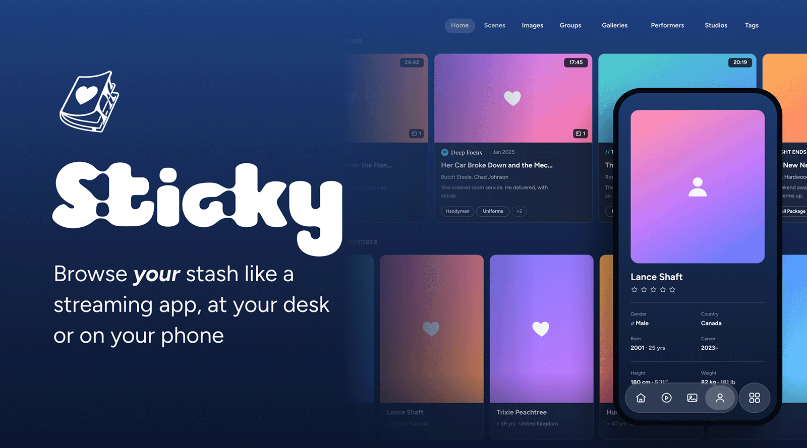
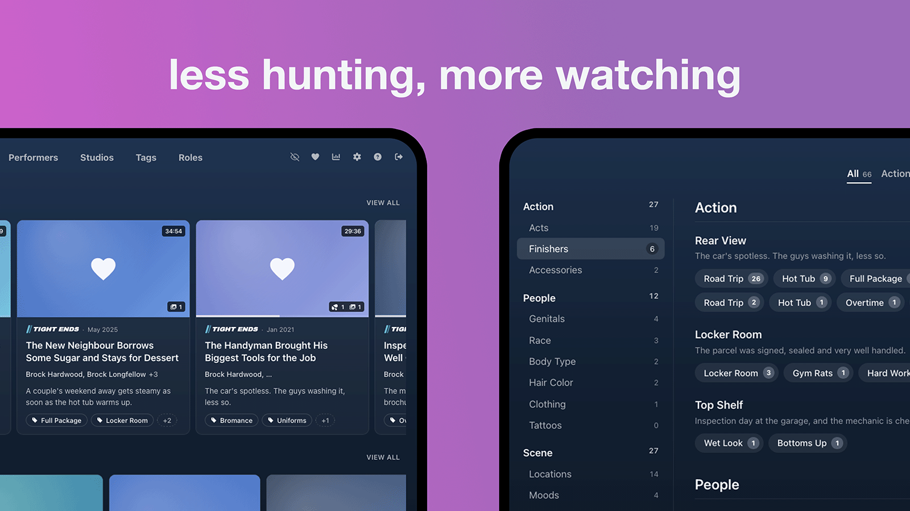
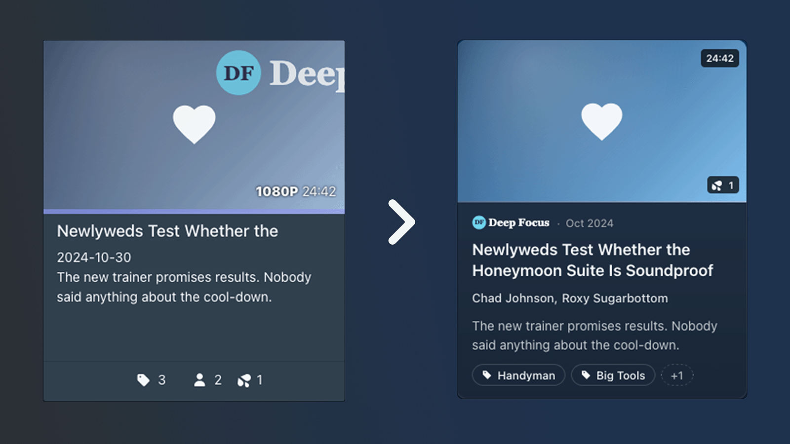
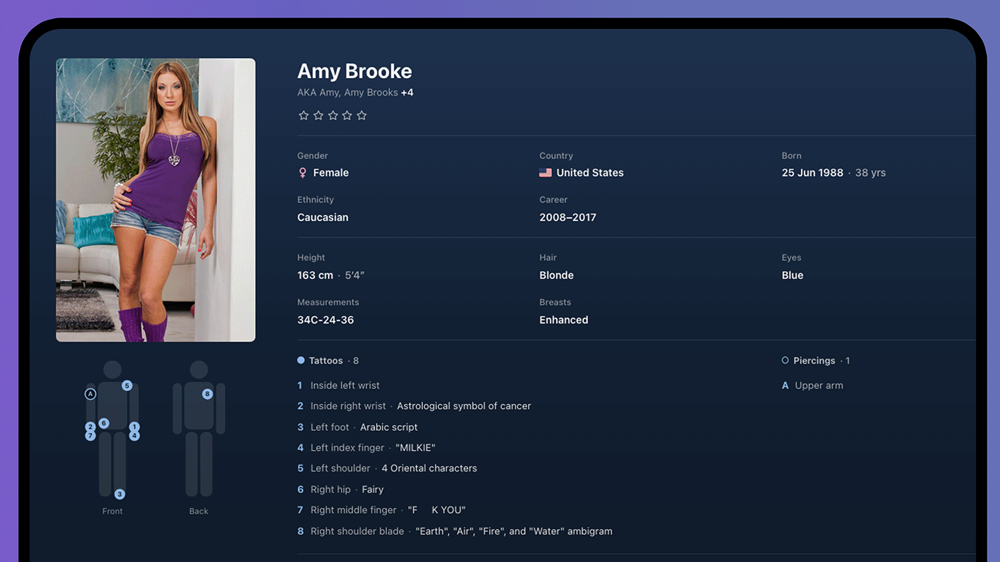
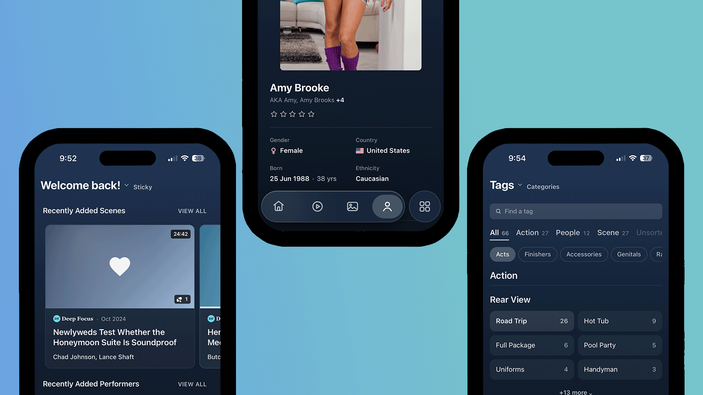

<p align="center">
  
</p>

<h1 align="center">Is your Stash sticky?</h1>

<p align="center">
  You built your collection. <a href="https://github.com/stashapp/stash">Stash</a> keeps it organised.<br>
  <b>Sticky makes it a <i>pleasure</i> to browse at your desk or on your phone.</b>
</p>

<p align="center">
  <a href="https://github.com/stashapp/stash"></a>
  
  <a href="LICENSE"></a>
</p>

<p align="center">
  <a href="#install"><kbd>&nbsp;<b>Install</b>&nbsp;</kbd></a>&nbsp;
  <a href="#whats-in-it"><kbd>&nbsp;What's in it&nbsp;</kbd></a>&nbsp;
  <a href="#settings"><kbd>&nbsp;Settings&nbsp;</kbd></a>&nbsp;
  <a href="#how-sticky-came-together"><kbd>&nbsp;The story&nbsp;</kbd></a>
</p>

<br>

## At your desk


<p align="center"><sub>Your Home page, and your tags grouped by category.</sub></p>

**Everything up front.** You don't need to hover or click to find out what something is. It's right there on the card.

- **Scene cards** see the full title, studio, date, who's in it and the tags.
- **Performer cards** show their age, their country and years they were active.
- **Hover** over any card and get even more.
- **Cards are slimmer**, now more fits on your screen.

### Tags, sorted

Your tags used to sit in one long list. Sticky sorts them under the parent tags you already have.

- **Pick a category**, like Action, People or Scene.
- **Pick a tag.** Each one shows a count beside it.
- **Done.** You're straight to the good part.

Every tag you own is now two clicks away.

### Cards, redesigned


<p align="center"><sub>Same scene, two looks. Stash does the organising. Sticky makes browsing the fun part.</sub></p>

<b>It's late at night, you're scrolling for something to watch.</b> Maybe it's your favourite performer. Maybe it's the scene you rented on DVD years ago and never forgot. 

- With the performers and tags hidden, you struggle to find it.
- Now, every card has been upgraded - you don't need to guess. Wasn't it <i>Newly weds Test Whether the Honeymoon Suite is Soundproof</i>? Oh yeah, that one.

### Performers, laid bare


<p align="center"><sub>Every detail in its place.</sub></p>

Get to know your faves without digging. 

- **Basics.** Gender, country, birthday and age.
- **Career.** The years they were active.
- **Their look.** Height, hair, eyes and measurements.
- **Tattoos and piercings.** An anatomical map showing where everything is.

<b>You'll always know where to look.</b>

## In your hand


<p align="center"><sub>Home, a performer and Tags, all one thumb away.</sub></p>

**Later, in bed, on your phone.**

- **Liquid glass bar at the bottom of the screen**, like YouTube's. Your four favourite pages are one tap away.
- **Cards made for a small screens**, for easier searching and your viewing pleasure.
- **Tags sorted for phones**, Scroll through category tabs along the top.

One-handed browsing, as nature intended.

## The whole package

<table>
  <tr>
    <td width="33%" valign="top">
      <h3>🎞️</h3>
      <b>Cards</b><br>
      Get the whole story (studio, date, title, cast and tags) all on one card.
    </td>
    <td width="33%" valign="top">
      <h3>🏠</h3>
      <b>Home redesign</b><br>
      Welcome back to your new modern streaming app.
    </td>
    <td width="33%" valign="top">
      <h3>🏷️</h3>
      <b>Tags by category</b><br>
      No more scrolling, tags are sorted under the parent tags you already have.
    </td>
  </tr>
  <tr>
    <td width="33%" valign="top">
      <h3>👤</h3>
      <b>Performer pages</b><br>
      Details in neat groups, plus a tattoo and piercing map.
    </td>
    <td width="33%" valign="top">
      <h3>📱</h3>
      <b>Phone bar</b><br>
      A glass bar with your four favourite pages.
    </td>
    <td width="33%" valign="top">
      <h3>🔍</h3>
      <b>One-row toolbar</b><br>
      Search, sort, filters and views on one line.
    </td>
  </tr>
  <tr>
    <td width="33%" valign="top">
      <h3>💗</h3>
      <b>Its own icon</b><br>
      On your browser tab and your iPhone Home Screen.
    </td>
    <td width="33%" valign="top">
      <h3>🎨</h3>
      <b>Everything matches</b><br>
      Settings, menus, pop-ups and the video player too.
    </td>
    <td width="33%" valign="top">
      <h3>📦</h3>
      <b>Ready to use/b><br>
      No dependencies, no bloat, one theme, one install.
    </td>
  </tr>
</table>

<p align="center">
  <br>
  <a href="#install"><kbd>&nbsp;<b>Install Sticky</b>&nbsp;</kbd></a>
</p>

## Install

Three steps. About a minute.

### 1&nbsp;&nbsp;Add Sticky to Stash

In Stash, go to **Settings → Plugins → Available Plugins → Add Source**. Name it `Sticky` and paste this link:

```
https://stickystash.github.io/Sticky/index.yml
```

### 2&nbsp;&nbsp;Install it

Open the new source, tick **Sticky** and click **Install**.

### 3&nbsp;&nbsp;Reload the page

That's it. Stash will let you know when there's an update.

<sub>Needs Stash v0.31 and a current Chrome, Brave, Edge or Firefox, or Safari 16+ on Mac, iPhone and iPad.</sub>

<details>
<summary><b>Install by hand instead</b></summary>
<br>

Copy this folder into your Stash plugins folder (for example `~/.stash/plugins/sticky/`). Then go to **Settings → Plugins → Reload plugins** and reload the page.

</details>

## Under the hood

### Choose your phone bar

Go to **Settings → Plugins → Sticky → Phone tab bar**. List your four pages in order, with commas between them:

```
home, scenes, images, performers
```

Everything else goes in the More menu.

### Turn it off

- **In one tab:** add `?sticky=off` to the address. Add `?sticky=on` to bring it back.
- **Everywhere:** disable it under **Settings → Plugins**.
- **To compare with Stash's own look:** use Troubleshooting mode, at the bottom of the Settings menu.

<details>
<summary><b>Match the login page too</b></summary>
<br>

Stash's login page loads before any plugin, so Sticky can't reach it. But a matching look is one paste away. Copy `extras/login.css` into **Settings → Interface → Custom CSS** and tick **Custom CSS enabled**. It only changes the login page.

</details>

## Other plugins

Most plugins pick up Sticky's look on their own. Pages they add to the menu show up in the More menu on your phone.

If one looks out of place, please [open an issue](../../issues) with a screenshot.

## How Sticky came together

A couple of months ago, I was flicking between Netflix on the TV and Stash on my phone, and it hit me. Why can't Stash feel like this?

So Sticky borrowed the best bits:

- **From Netflix:** rows of content that make you want to press play.
- **From YouTube:** Streamlined video cards, bar at the bottom of your phone, right under your thumb.

One rule from day one: restyle, don't rebuild. Every page is still the Stash you know underneath. It just looks more inviting.

Huge thanks to the hard working Stash developers. None of this exists without the thing they built.

<sub>Sticky was built with help from Claude Opus 5.5, Which wrote much of the code under my direction. I reviewed every change, tested it on a live Stash install on desktop and iPhone, and I take responsibility for the code. Issues and pull requests are welcome.</sub>

<details>
<summary><b>Development</b></summary>
<br>

- Sticky is plain JavaScript and CSS, with no build step to run it. Drop the folder into `plugins/`, reload plugins, and edit in place.
- `sh build.sh` builds the plugin source (`_site/index.yml` and `_site/sticky.zip`). The GitHub Actions workflow in `.github/workflows/pages.yml` runs it and publishes `_site/` to GitHub Pages on every push to `main`.
- Each script and stylesheet opens with a comment explaining what it does and why. Read those before changing anything.

</details>

<br>

<p align="center">
  <sub>MIT licence. See <a href="LICENSE">LICENSE</a>.<br>Sticky isn't affiliated with the Stash project.</sub>
</p>
